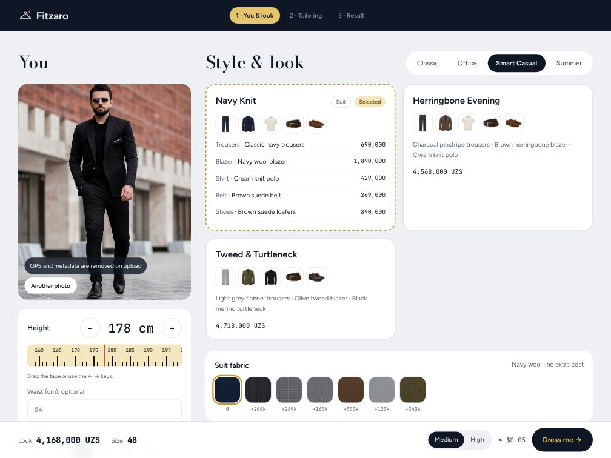
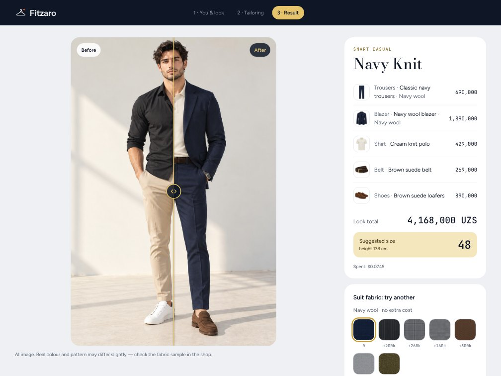
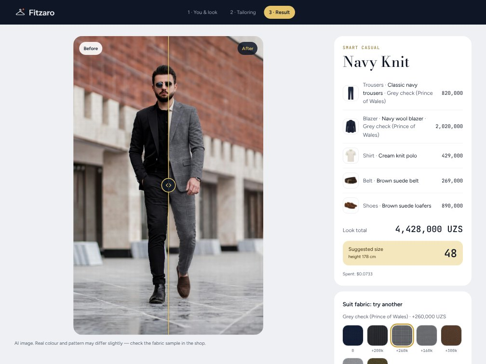

# Fitzaro — virtual fitting room

Upload a full-length photo, pick a look and a fabric, and see yourself wearing it, with a suggested size and the total price.

The demo is set up for a menswear shop: suits, separates, accessories and seven fabrics. The catalogue, prices and size charts are the shop's own data. The AI only does the fitting.


| Choose a look and fabric                              | Result with size and price                | Same photo, another fabric                          |
| ----------------------------------------------------- | ----------------------------------------- | --------------------------------------------------- |
|  |  |  |

These come from a real run against the OpenAI Images API, about $0.07 per image. The model photo is from Unsplash ([credits](public/media/CREDITS.md)).

## What's in it

- **The fitting.** The customer photo and the product images go to `/v1/images/edits` as references. The result keeps the photo's aspect ratio, and the prompt pins face, pose and framing, so the person in the result is still the same person.
- **Suits and separates.** In a suit look the fabric, and its surcharge, applies to both jacket and trousers. In separates it applies to the trousers only. The rule lives in PHP and in TypeScript, with tests on both sides.
- **Another fabric, same photo.** The result screen re-tailors the look in a different fabric without uploading the photo again.
- **Your own key.** Visitors bring their own OpenAI key and pay for their own images. Without a key, `auto` mode returns a free mock result marked "demo". The key is never saved on the server.
- **No surprise bills.** The estimated cost shows before every generation and the real cost (from the API's `usage`) after it. Failed calls are never retried automatically, so nobody pays twice for one picture.
- **Photos are handled carefully.** Every upload is re-encoded, which drops EXIF and GPS. Files sit on a private disk behind short-lived signed URLs. Uploads are deleted after 24 hours, results after 7 days.
- **A slider that works for everyone.** Before/after is a native range input laid over the image, so mouse, touch, arrow keys and screen readers all work. The result appears only once it has fully loaded.

Next up: tops, dresses and eyewear with colour variants, a shop-owner key with a monthly budget, per-visitor limits and an admin screen. The suit module stays, behind a config flag.

## Stack

| Layer    | Tech                                                                                                             |
| -------- | ---------------------------------------------------------------------------------------------------------------- |
| Backend  | Laravel 13, PHP 8.5, PostgreSQL 18, database queue, Fortify                                                      |
| Frontend | Inertia 3, Vue 3 (Composition API, `<script setup>`), TypeScript, Tailwind CSS 4, shadcn-vue, motion-v, vue-i18n |
| Tooling  | Laravel Sail (Docker), Vite+ (`vp test` / `vp check`), Wayfinder (typed routes), PHPUnit, Vitest                 |

## How it's put together

**Backend** (`app/TryOn`). A `TryOnProvider` contract with two implementations, `MockProvider` and `OpenAiProvider`; `ProviderFactory` picks one from `TRYON_PROVIDER` (`mock`, `openai` or `auto`). The generation runs in `TryOnJob` on the queue: encrypted payload, one try, and an atomic status change so a request can't be processed twice. Around it: `PromptBuilder`, `ImageService` (validation, re-encoding, storage), `SizeSuggester`, and `OpenAiErrors`, which turns API errors into messages a customer can understand.

**Frontend** (`resources/js`) uses [Feature-Sliced Design](https://feature-sliced.design/):

```
app → pages → widgets → features → entities → shared
```

Imports only go down, and a slice is reached only through its `index.ts`. `app/architecture.test.ts` checks both rules in CI. Business logic is plain TypeScript in `model/` folders, reactivity lives in composables, and components mostly render. The try-on wizard is a small state machine in `widgets/try-on-wizard/model/flow.ts`.

**Security.** CSP with a per-request nonce. The API key is accepted only in the `X-OpenAI-Key` header, and middleware strips it before anything is logged. Requests belong to the session and use UUIDs. Rate limits are on, and only the status codes of OpenAI errors go to the log.

## Run it locally

You need Docker Desktop and Node 24.

```
git clone https://github.com/aurshax/boutique-ai.git
cd boutique-ai
cp .env.example .env
docker run --rm -u "$(id -u):$(id -g)" -v "$(pwd):/var/www/html" -w /var/www/html laravelsail/php85-composer:latest composer install
./vendor/bin/sail up -d
./vendor/bin/sail artisan key:generate
./vendor/bin/sail artisan migrate --seed
npm install
npm run dev
```

In a second terminal, start the queue worker:

```
./vendor/bin/sail artisan queue:work --timeout=180 --tries=1
```

Open http://localhost. The try-on page is `/try-on`.

Out of the box `TRYON_PROVIDER=mock`: free, no key, a fake result. Switch to `auto` or `openai` and use your own OpenAI key for real images.

Tests and checks:

```
./vendor/bin/sail artisan test
npx vp test
npx vp check
```

The screenshots above can be retaken with `scripts/capture-screenshots.mjs` (see [Development](docs/DEVELOPMENT.md#screenshots-and-video)).

## Deploying

[`docs/DEPLOY.md`](docs/DEPLOY.md) and `.env.production.example` cover it: a private S3-compatible bucket for photos, a queue worker, the scheduler (`try-on:prune`), `AUTH_REGISTRATION=false` and `TRUSTED_PROXIES`.

## More docs

- [Architecture](docs/ARCHITECTURE.md): request flow, data model, provider modes, frontend layers, security
- [Development](docs/DEVELOPMENT.md): local setup, commands, troubleshooting, screenshots
- [Deployment](docs/DEPLOY.md): production settings and a checklist

## Credits and licence

- Code: [MIT](LICENSE).
- Photos and videos in `public/media/hero` and `public/media/fabrics/fabric-*` are under the [Unsplash License](https://unsplash.com/license) and the [Pexels License](https://www.pexels.com/license/), with authors listed in [`public/media/CREDITS.md`](public/media/CREDITS.md). The MIT licence does **not** cover them.
- Product images and fabric swatches (`public/media/catalog`, `public/media/fabrics/swatch-*`) were generated with AI for this demo.
- Started from the [Laravel Vue starter kit](https://github.com/laravel/vue-starter-kit) (MIT).
